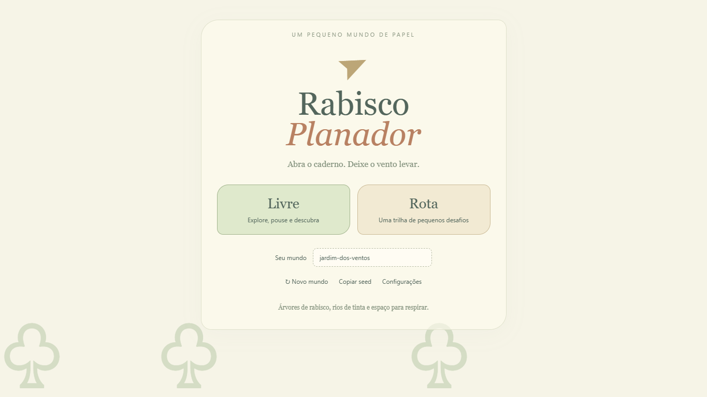
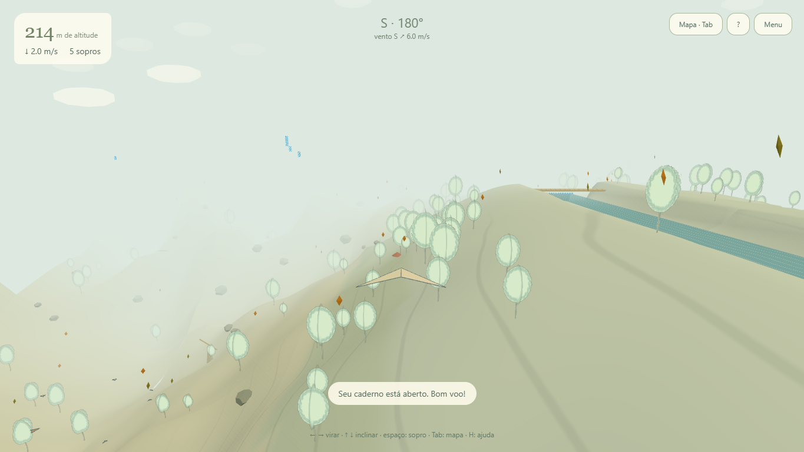

# Rabisco Planador

Um jogo de avião de papel em um mundo desenhado no caderno. O **Modo Rota** reúne desafios e coleções; o **Modo Livre** permite explorar relevo, rios, cachoeiras e correntes de vento sem pontuação obrigatória ou fim de partida.



## Jogar

Baixe o repositório e abra [game3.html](game3.html) no Edge ou Chrome. O HTML inclui JavaScript, CSS, Three.js e o Worker: não exige servidor ou conexão para jogar. O navegador guarda o progresso localmente. A seed repete o mundo, mas não transfere as descobertas de outro jogador.

## Desenvolver

Requisitos: Node.js **22.12+ na linha 22 ou 24+**, npm e navegador com WebGL.

```sh
npm ci
npm run dev
```

Abra o endereço indicado pelo Vite. Para verificar e compilar:

```sh
npm test
npm run docs:check
npm run memory:check
npm run build
```

O build gera `dist/game3.html`. Após mudanças no jogo, `npm run release` compila e atualiza também o HTML da raiz. Não edite a distribuição manualmente: `src/` é a fonte de verdade.

## Controles rápidos — Livre

| Ação | Controle |
| --- | --- |
| Virar | ← / → ou A / D |
| Baixar / levantar o nariz | ↑ / ↓ ou W / S |
| Sopro | Espaço |
| Relançar no chão | Segure Espaço, mire e solte |
| Mapa e álbum | Tab |
| Ajuda | H ou ? |
| Qualidade | Q |
| Silenciar | M |
| Diagnóstico | F3 |
| Menu | Esc |

No celular, arraste para guiar e use **Soprar**. No chão, segure e solte o botão. As diferenças da Rota estão no [guia de jogo](docs/JOGABILIDADE.md).

## Documentação

| Documento | Conteúdo |
| --- | --- |
| [Arquitetura](docs/ARQUITETURA.md) | Módulos, execução, Worker e renderização |
| [Vento e ciclo](docs/VENTO_E_CICLO.md) | Como aproveitar correntes, tarde e transições suaves |
| [Navegação e missões](docs/NAVEGACAO_MISSOES.md) | Plano, bússola, bandeira de vento e objetivos no mapa |
| [Jogabilidade](docs/JOGABILIDADE.md) | Controles, voo, pouso e exploração |
| [Mundo](docs/MUNDO.md) | Seed, relevo, água, chunks, biomas e configuração |
| [Estilo visual](docs/ESTILO_VISUAL.md) | Tema compartilhado, implementação local e critérios da issue #1 |
| [Persistência](docs/PERSISTENCIA.md) | localStorage, formato de save e evolução |
| [Desenvolvimento](docs/DESENVOLVIMENTO.md) | Build, depuração, manutenção e release |
| [Validação visual](docs/VALIDACAO_VISUAL.md) | Capturas desktop/móvel e custo antes/depois |
| [Testes](docs/TESTES.md) | Evidências, cobertura e limitações |
| [Memória](MEMORY.md) | Contexto persistente para futuras sessões |
| [Histórico](CHANGELOG.md) | Entregas |

## Estado atual

Versão **3.0.0**, com mundo de 4096 × 4096 m, blocos de 128 m e pelo menos três quedas principais por seed. A geração do terreno e a física consultam o mesmo modelo de altura.



Seis testes automatizados passaram na entrega inicial. Verificações de navegador cobriram Worker, mapa, salvamento, qualidade, relançamento e entrada na Rota. As metas de 60 fps em desktop e 30 fps em celular físico ainda precisam de medição no aparelho. Consulte [evidências e limites](docs/TESTES.md).

Ao retomar o desenvolvimento, leia [AGENTS.md](AGENTS.md), [MEMORY.md](MEMORY.md) e [.memory/state.json](.memory/state.json). A memória do projeto não contém saves pessoais nem concede autorização para ações externas.

A licença MIT do Three.js está em [THIRD_PARTY_LICENSES.txt](THIRD_PARTY_LICENSES.txt).
