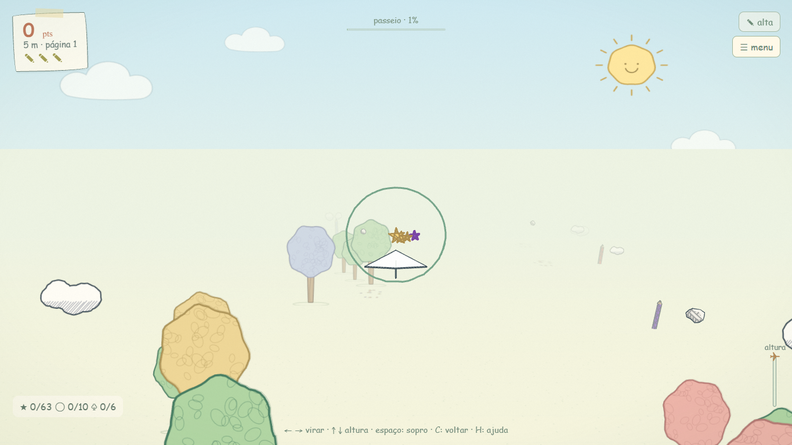
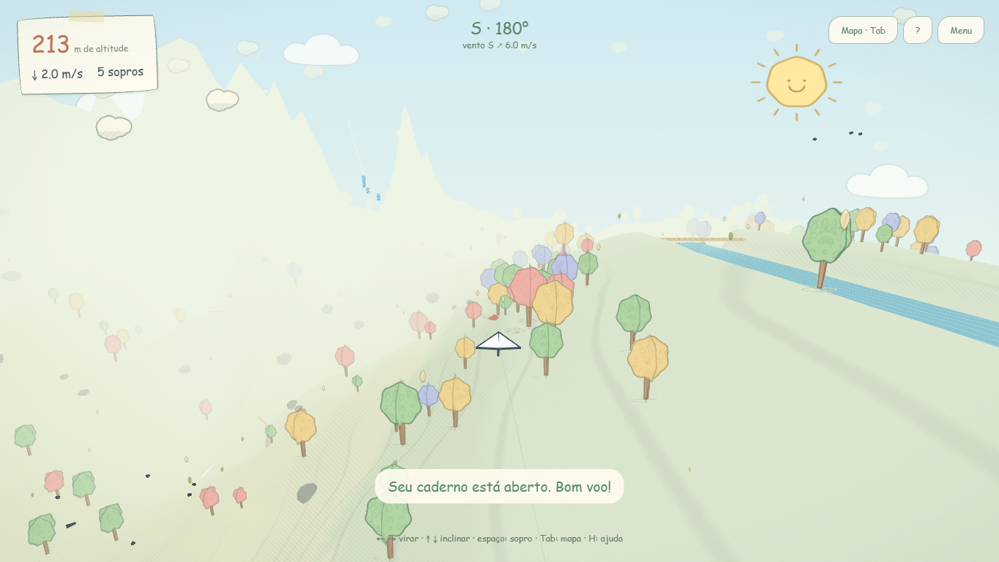

# Validação do alinhamento visual — issue #1

Implementação validada em 2026-10-09 e entrega aprovada pelo usuário. Este documento acompanha o commit de implementação da issue #1.

## Resultado e arquitetura

- `src/render/theme.js`: LOOK compartilhado, tinta/papel e materiais de hachura com luz simplificada, grão discreto e adaptação ao dia/noite.
- `src/render/paper-art.js`: desenhos de céu, chão, quatro árvores pastel, nuvens, flores e sombra extraídos da Rota. Ambas as cenas usam esses geradores; não se inicializa a Rota para obter assets.
- `src/render/assets.js`: geometria de avião compartilhada, papel, dobras e contorno; coletáveis com silhueta desenhada de pena/folha.
- Livre: atlas de árvores com variantes por instância, nuvens em planos com duas texturas, flores esparsas, sombras/rastro e contorno seletivo em objetos próximos. A névoa e as casas/ponte/balões recebem acabamento ilustrado. Noite mantém papel e tinta com tons escuros.
- Interface: cartões irregulares, fita, botões e mapa com escrita da mesma família. A pilha offline explicitamente escolhida é Comic Sans MS → Segoe Print → Chalkboard SE → cursive. Não há download de fontes; a família instalada pode variar entre sistemas, mas os modos usam a mesma pilha.

A física, o modelo procedural, os chunks e os IDs persistidos não foram alterados. A Rota mantém suas texturas e shaders anteriores, consumindo os helpers extraídos. O contorno do Livre usa linhas espessas no avião e linhas simples seletivas em adereços; não aplica hull a todo o mundo.

## Capturas comparativas

Seed do Livre: `jardim-dos-ventos`; versão 3.0.0 com alterações visuais desta tarefa. Desktop 1365 × 768 em alta; móvel emulado 390 × 844 em leve. Posições de revisão são estabilizadas com o hook `?test=1`, não demonstram habilidade de voo. Capturas não são comparação pixel a pixel entre mapas diferentes.

| Cena | Desktop | Móvel |
| --- | --- | --- |
| Referência Rota | [Rota](images/review-route-desktop.png) | [Rota](images/review-route-mobile.png) |
| Livre inicial | [Inicial](images/review-free-start-desktop.png) | [Inicial](images/review-free-start-mobile.png) |
| Floresta | [Floresta](images/review-free-forest-desktop.png) | [Floresta](images/review-free-forest-mobile.png) |
| Cachoeira | [Cachoeira](images/review-free-waterfall-desktop.png) | [Cachoeira](images/review-free-waterfall-mobile.png) |
| Vila | [Vila](images/review-free-village-desktop.png) | [Vila](images/review-free-village-mobile.png) |
| Mapa | [Mapa](images/review-free-map-desktop.png) | [Mapa](images/review-free-map-mobile.png) |
| Noite | [Noite](images/review-free-night-desktop.png) | [Noite](images/review-free-night-mobile.png) |




## Verificações

- Dez testes Node passaram: seis de mundo/voo e quatro de memória.
- Browser smoke: menu, Worker, mapa, persistência após reload, troca Q, pouso/lançamento carregado, retorno ao menu, Rota e toque sem rolagem horizontal passaram.
- Capturas desktop/móvel, noite e vila sem erros de JavaScript ou shader.
- Travessia repetida de quatro regiões, três ciclos: geometrias GPU 290, 290 e 290; sem crescimento contínuo nessa amostra.
- Build portátil executado com `npm run release`.

## Custo medido

Edge headless com SwiftShader; amostra de frame inicial após carregamento/pausa, mesma seed e viewport. A vida ambiente e o tempo de carregamento podem variar o frame; isto não é medição de fps em hardware.

| Perfil | Desenhos antes / depois | Triângulos antes / depois | Chunks |
| --- | --- | --- | --- |
| Alta desktop | 107 / 125 | 29851 / 25661 | 49 |
| Leve móvel emulado | 38 / 46 | 12850 / 10435 | 25 |

Os detalhes e contornos acrescentam chamadas de desenho; os planos de nuvem e modelos simplificados reduzem triângulos. Essa troca não prova ganho ou perda de fps no aparelho. As metas físicas de 60/30 fps continuam sem certificação. Dados: [custo](visual-budget.json) e [cenas](visual-review.json).

## Reproduzir

```sh
npm ci
npm run release
npm test
npm run test:browser
npm run test:visual
npm run docs:check
npm run memory:check
```

Os runners usam Playwright declarado como dependência de desenvolvimento. No Windows, o padrão é Edge instalado. Para Chromium instalado pelo Playwright: execute `npx playwright install chromium` e defina `RABISCO_BROWSER=chromium`. Para software GPU, defina `RABISCO_SOFTWARE_GPU=1`. Em PowerShell: `$env:RABISCO_SOFTWARE_GPU='1'`. Capturas ficam em docs/images; artefatos do smoke ficam em test-results, ignorados pelo Git. Esses comandos não fazem commit nem encerram a issue.
